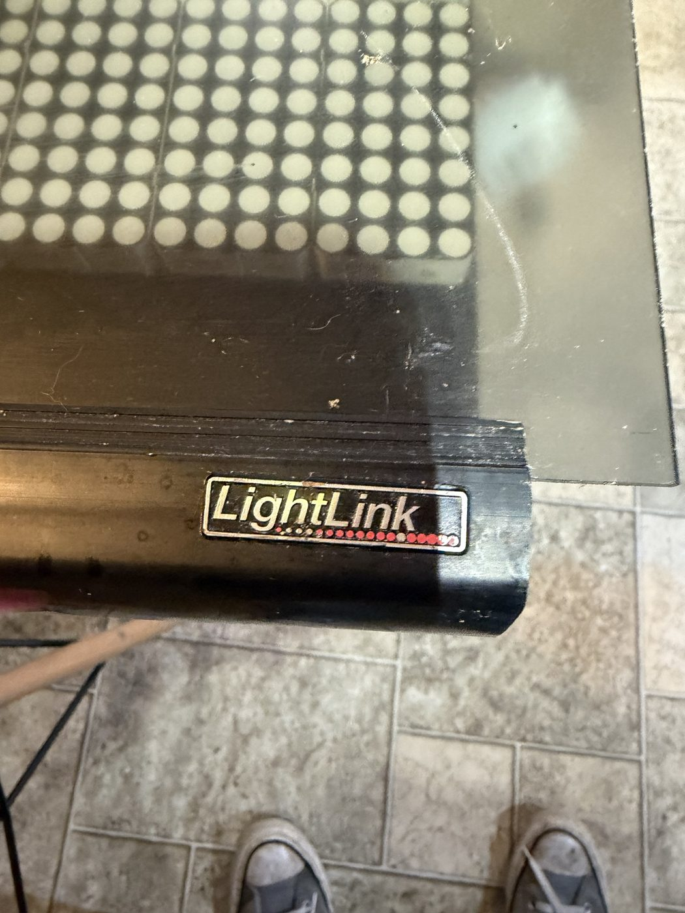

# LightLink ESP8266

WiFi replacement controller for the **Inova LightLink CFM16.200** LED sign (1998, 200 x 16 pixels,
red / green / orange). The original controller could only be programmed with expensive proprietary
software. This project replaces it with an ESP8266 that drives the original panel boards directly
and adds a web interface, a playlist, `.fseq` sequence playback, and live control from
Falcon Player (FPP) or xLights.



## Features

- **Web UI** with a live preview of the sign, quick messages, a playlist editor, a file manager and settings
- **Text** in 5 fonts, red / green / orange / cycling color, static / scroll / blink, with
  `{time}` `{time12}` `{date}` `{ip}` `{host}` tokens (NTP time)
- **FSEQ playback** from flash: xLights / FPP V1 or V2-uncompressed sequences
- **Live input** from Falcon Player or xLights over **DDP** (UDP 4048) and **E1.31 / sACN** unicast (UDP 5568)
- **Test patterns** and orientation toggles, so no reflashing to fix a mirrored or swapped display
- WiFi setup access point, mDNS name (`<hostname>.local`), OTA updates, optional HTTP basic auth
- **REST API** for scripts, Home Assistant, chat bots and similar

## Status

Running on a real CFM16.200: both bands, all five panels per band, red, green and orange
all verified.

## Documentation

| Guide | What's in it |
|---|---|
| [Hardware and wiring](docs/hardware.md) | How the panels work, ribbon pinout, parts list, wiring diagram, photos |
| [Building](docs/building.md) | Compiling from source with PlatformIO or the Arduino IDE |
| [Flashing](docs/flashing.md) | Installing esptool (macOS, Linux, Windows) and flashing the prebuilt binary |
| [First-time setup](docs/setup.md) | Joining WiFi, setting the hostname, finding the IP, bring-up tests |
| [Usage](docs/usage.md) | Web UI, messages, playlists, sequences, FPP / xLights, REST API, Home Assistant |
| [Troubleshooting](docs/troubleshooting.md) | Symptoms and fixes, including what a broken data line looks like |
| [Interface PCB](docs/pcb.md) | Through-hole board: PCBWay ordering, BOM, assembly, KiCad files |

## Quick start

1. Build the interface: a Wemos D1 mini or NodeMCU and two 74HCT245 buffers between the ESP8266 and the
   two panel ribbons, either hand-wired ([hardware.md](docs/hardware.md)) or on the
   [interface PCB](docs/pcb.md).
2. Flash [`firmware/lightlink-d1mini-4M3M-v1.0.0.bin`](firmware/) with esptool. See [flashing.md](docs/flashing.md).
3. Join the **LightLink-XXXX** WiFi network (password `lightlink`), browse to `http://192.168.4.1`,
   and enter your WiFi details. See [setup.md](docs/setup.md).
4. Open `http://<hostname>.local`, run **Setup → ident**, then start sending messages.

```
curl -X POST 'http://lightlink.local/api/message?text=Hello%20world&color=green&effect=scroll'
```

## Repository layout

```
src/            firmware source (PlatformIO / Arduino, ESP8266)
firmware/       prebuilt image for a Wemos D1 mini (4 MB flash)
tools/          make_test_fseq.py: generates a test sequence
docs/           guides, wiring diagram and photos
hardware/pcb/   KiCad project, Gerbers for PCBWay, BOM for the interface board
.github/        CI workflow that builds the firmware on every push
```

## Credits

- The panel interface (signal list, ribbon pinout, row addressing) comes from **Yadid Ramot's**
  PIC24 + ESP8266 replacement controller for LightLink signs:
  [hackaday.io/project/8365](https://hackaday.io/project/8365) and
  [github.com/eyadid/esp-led-controller](https://github.com/eyadid/esp-led-controller).
- Built with the [ESP8266 Arduino core](https://github.com/esp8266/Arduino),
  [Adafruit GFX](https://github.com/adafruit/Adafruit-GFX-Library) and
  [ArduinoJson](https://arduinojson.org/).
- FSEQ format per [Falcon Player](https://github.com/FalconChristmas/fpp); DDP per [3waylabs](http://www.3waylabs.com/ddp/).

## License

MIT. See [LICENSE](LICENSE).
