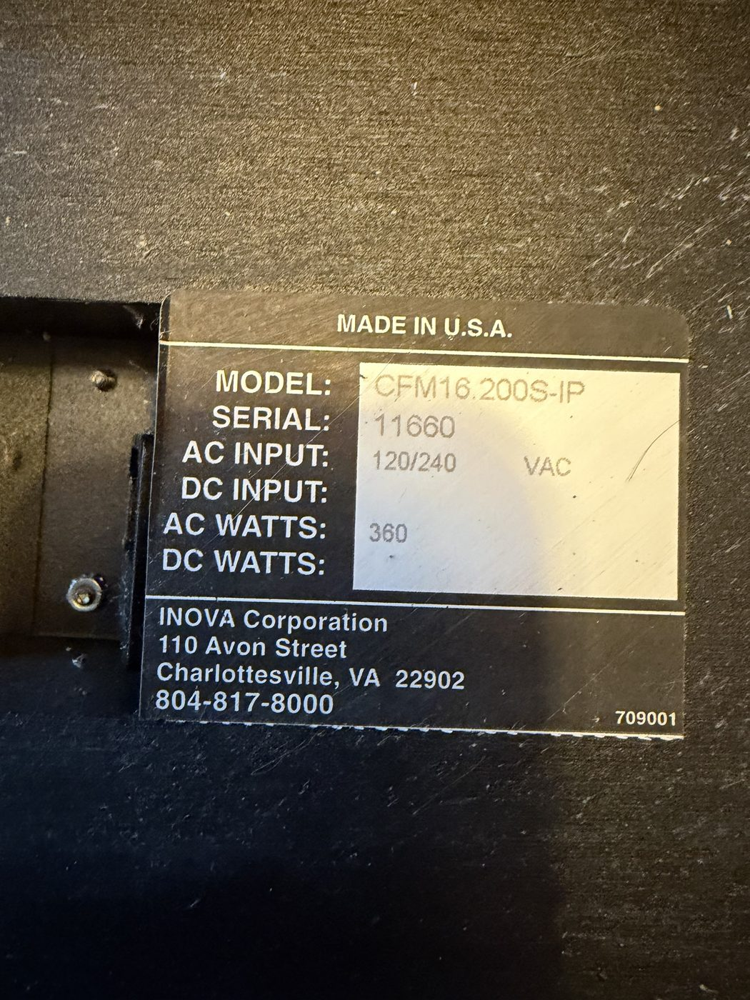
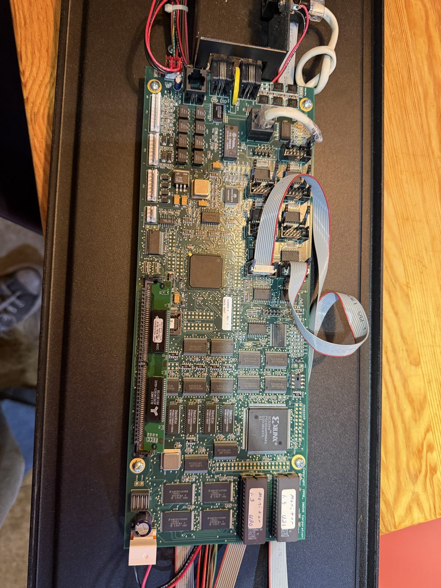
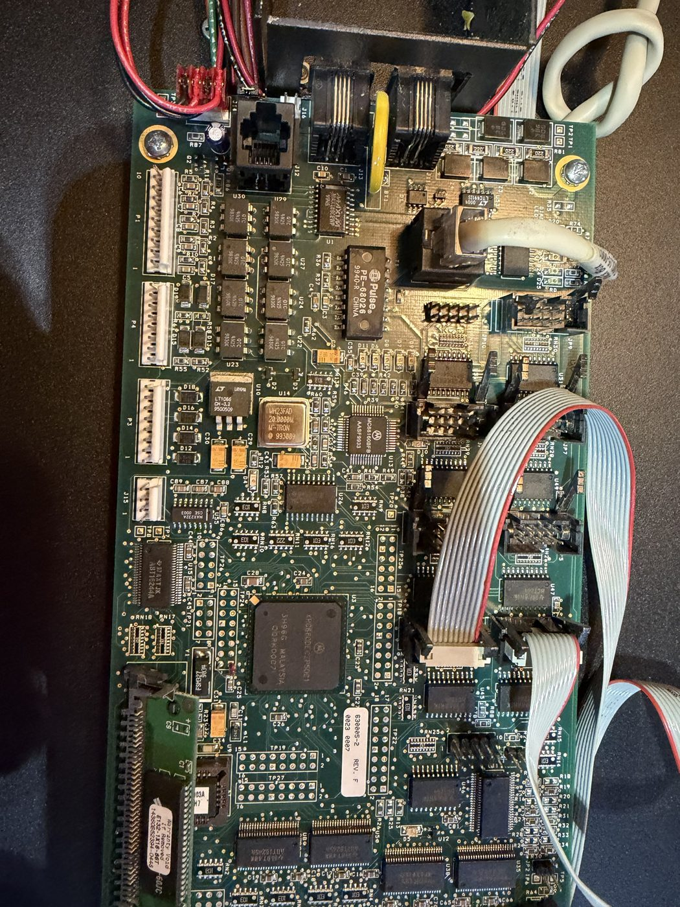
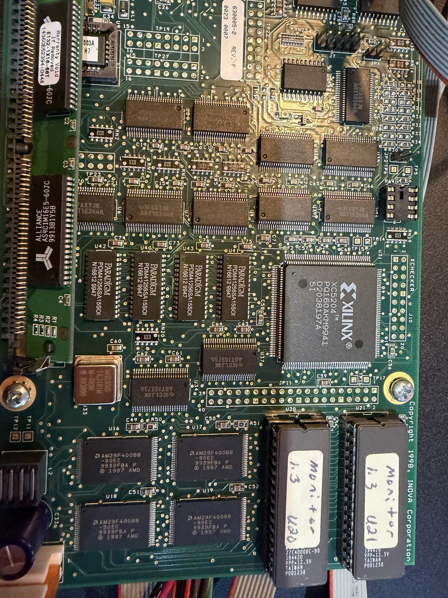
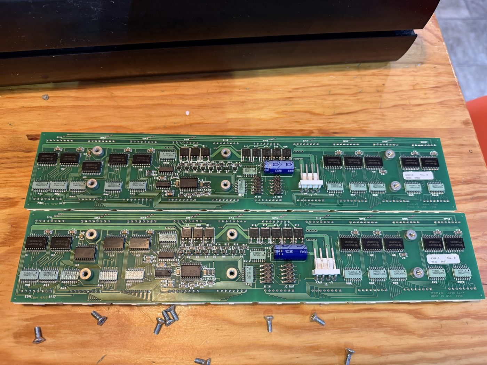
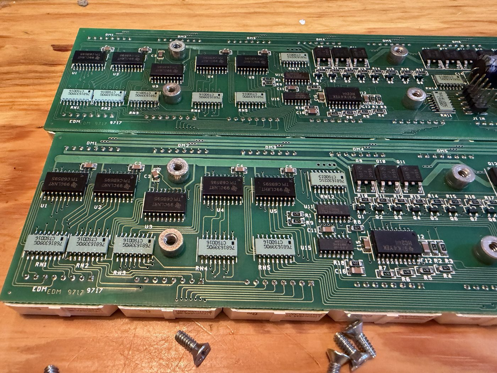
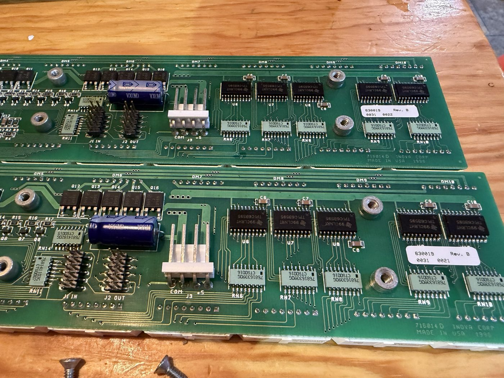
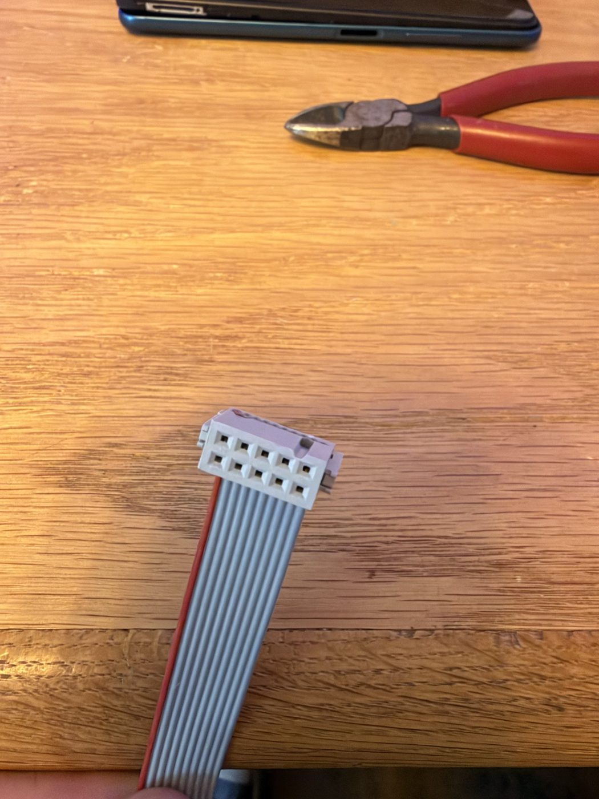
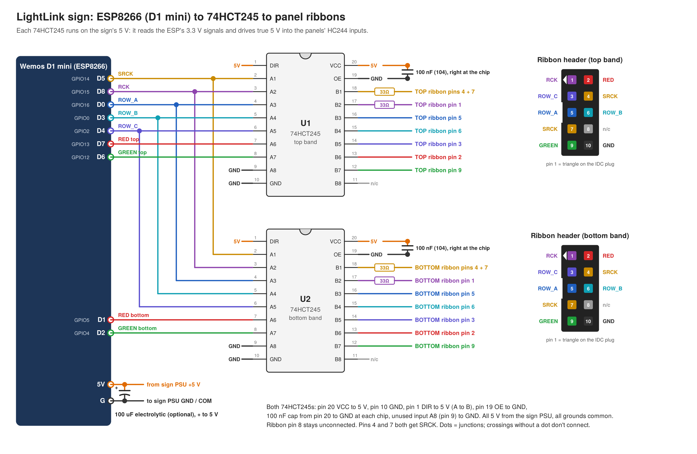

# Hardware and wiring

This guide covers how the LightLink panels work, what to buy, and how to wire an ESP8266 to the
sign. The original controller board is not used.

- [The sign](#the-sign)
- [How the panels are driven](#how-the-panels-are-driven)
- [Ribbon pinout](#ribbon-pinout)
- [Parts list](#parts-list)
- [Wiring](#wiring)
- [Power](#power)
- [No level shifter on hand?](#no-level-shifter-on-hand)
- [Bring-up checks before power](#bring-up-checks-before-power)

## The sign

| | |
|---|---|
|  | **Inova LightLink CFM16.200S-IP**, made in the USA by INOVA Corporation, Charlottesville, VA. 120/240 VAC, 360 W. 200 x 16 bicolor pixels. |

### Original controller (removed)

For reference only; nothing here is needed for this project. Board 630005-2 Rev F (1998):

- Motorola MPC860 PowerQUICC CPU with an MC68160 10BASE-T transceiver and Pulse magnetics
- Xilinx XC5204 FPGA, which generated the panel timing
- Two 27C4000 EPROMs labelled "Monitor 1.3", four AM29F400 flash chips, a 72-pin SIMM and SRAM
- A MAX232 (RS-232) and 4N25 opto-isolated inputs

The original firmware spoke an undocumented UDP protocol. Nobody has published it, which is
why this project drives the panels directly instead.

| | |
|---|---|
|  |  |

### Panel boards (kept)

Each **630019 Rev B** panel board carries ten bicolor dot-matrix blocks: 40 columns x 8 rows.

| | |
|---|---|
|  |  |

- **U1-U10: TPIC6B595** power shift registers. They sink the LED columns: 40 red outputs and 40 green.
- **U12: 74HC244** input buffer. It re-drives the ribbon signals and passes them on to the next board.
- **U11/U15** appear to decode the 3-bit row address, and **Q1-Q16** switch the 8 rows.
- **J1 IN / J2 OUT** are 2x5 headers for daisy-chaining boards. **J3** (`COM` / `+5`) brings in power from the sign's supply.

Five boards chain together to make one **band** of 200 x 8 pixels. The sign has two bands, top and bottom.

## How the panels are driven

The display is 1:8 multiplexed. For each row in turn, the firmware:

1. shifts 200 red bits and 200 green bits into each band. Red and green are separate shift chains
   that share one clock (SRCK), so 4 data bits go out per clock: top red, top green, bottom red, bottom green.
2. sets the 3-bit row address (ROW_A = MSB ... ROW_C = LSB).
3. pulses RCK, which latches the new column data onto the LEDs.

A timer interrupt runs this scan at 150 Hz (1,200 rows a second). Brightness works by latching
all-zeros partway through each row period.

## Ribbon pinout

Each band has one 10-wire ribbon. The pinout comes from Yadid Ramot's working replacement
controller and has been confirmed on this sign.

| Pin | Signal | Notes |
|----:|--------|-------|
| 1 | RCK | latch, rising edge |
| 2 | RED data | serial in, red chain |
| 3 | ROW_C | row address bit 0 (LSB) |
| 4 | SRCK | shift clock, rising edge |
| 5 | ROW_A | row address bit 2 (MSB) |
| 6 | ROW_B | row address bit 1 |
| 7 | SRCK | drive together with pin 4 |
| 8 | n/c | **leave unconnected** |
| 9 | GREEN data | serial in, green chain |
| 10 | GND | |

### Reading the plug

The **red stripe is wire 1**, and the cables are wired straight through, so both ends have the
same numbering. Looking into the holes with the red stripe on the left, each column holds two pins:

| Column | 1 (red stripe) | 2 | 3 | 4 | 5 |
|---|---|---|---|---|---|
| Odd row | 1 RCK | 3 ROW_C | 5 ROW_A | 7 SRCK | 9 GREEN |
| Even row | 2 RED | 4 SRCK | 6 ROW_B | 8 n/c | 10 GND |

To tell which row is odd, plug the cable into a panel (sign unplugged) and check continuity from
the two holes in column 5 to the panel's J3 `COM`. The hole that beeps is **pin 10 (GND)**, which
marks the even row.

Male DuPont jumpers fit the IDC holes, so you can test without soldering a header.

## Parts list

| Qty | Part | Notes |
|---:|---|---|
| 1 | **Wemos D1 mini** (ESP8266, 4 MB flash) | A NodeMCU works too; use the `nodemcuv2` build |
| 2 | **74HCT245** octal buffer, DIP-20 | e.g. [Juried Engineering SN74HCT245N 5-pack](https://www.amazon.com/Juried-Engineering-SN74HCT245N-Transceivers-Breadboard-Friendly/dp/B08FZN8WM1). 74HCT541 also works. |
| 2 | **100 nF ceramic capacitor** (marked `104`) | one per 74HCT245. e.g. [DYWISHKEY 24-value ceramic kit](https://www.amazon.com/DYWISHKEY-Monolithic-Multilayer-Capacitors-0-1uF-100nF/dp/B07QGDGGZV) |
| 4 | **33 Ω resistor** | series damping on SRCK and RCK. Anything from 22-100 Ω works (47 Ω, or 22 + 10 in series). |
| 1 | 47-220 µF electrolytic, 10 V+ | optional bulk cap on the D1 mini's 5 V |
| - | DuPont jumpers or 2x5 IDC headers, breadboard or perfboard | |

**Why buffers:** the panels' input buffer is a **74HC244** running at 5 V, which needs about
3.5 V for a valid logic high. The ESP8266 outputs 3.3 V. A **74HCT** part powered from 5 V accepts
anything above 2 V as high and outputs a full 5 V. Plain 74HC or 74LS chips will not work as the
buffer.

## Wiring

([SVG version](images/wiring.svg))

| D1 mini | GPIO | Signal | 74HCT245 input | Output to ribbon |
|---|---|---|---|---|
| D5 | 14 | SRCK | U1 A1 (pin 2) **and** U2 A1 | B1 (pin 18) → 33 Ω → ribbon pins **4 and 7** |
| D8 | 15 | RCK | U1 A2 (pin 3) **and** U2 A2 | B2 (pin 17) → 33 Ω → ribbon pin **1** |
| D0 | 16 | ROW_A | U1 A3 (pin 4) **and** U2 A3 | B3 (pin 16) → ribbon pin **5** |
| D3 | 0 | ROW_B | U1 A4 (pin 5) **and** U2 A4 | B4 (pin 15) → ribbon pin **6** |
| D4 | 2 | ROW_C | U1 A5 (pin 6) **and** U2 A5 | B5 (pin 14) → ribbon pin **3** |
| D7 | 13 | RED, top band | U1 A6 (pin 7) | U1 B6 (pin 13) → **top** ribbon pin **2** |
| D6 | 12 | GREEN, top band | U1 A7 (pin 8) | U1 B7 (pin 12) → **top** ribbon pin **9** |
| D1 | 5 | RED, bottom band | U2 A6 (pin 7) | U2 B6 (pin 13) → **bottom** ribbon pin **2** |
| D2 | 4 | GREEN, bottom band | U2 A7 (pin 8) | U2 B7 (pin 12) → **bottom** ribbon pin **9** |
| G | | GND | | ribbon pin **10** (both) |

Fixed connections on **each** 74HCT245:

| Pin | Connect to |
|---|---|
| 20 VCC | 5 V, with a 100 nF cap from pin 20 to GND right at the chip |
| 10 GND | GND |
| 1 DIR | 5 V (A → B direction) |
| 19 OE | GND (outputs always on) |
| 9 A8 | GND (unused input) |
| 11 B8 | leave open |

Ribbon pin 8 stays unconnected. GPIO0, GPIO2 and GPIO15 are ESP8266 boot-mode pins. They only
drive high-impedance inputs here, so the board still boots normally, as long as the 245s are
powered (see below). The D1 mini's blue LED (GPIO2) flickers with the row scan; that's expected.

To use other pins, edit `src/config.h`. Data, SRCK and RCK must stay on GPIO 0-15.

## Power

- Everything runs from the **sign's own 5 V supply**: the panels (J3 `+5` / `COM`), both
  74HCT245s and the D1 mini's **5V** pin. All grounds are common.
- **Don't connect USB and the sign's 5 V at the same time.** When flashing over USB, disconnect the
  wire from the sign's 5 V. USB then powers the D1 mini, which feeds the 245s through its 5V pin.
- **An unpowered 74HCT245 stops the ESP from booting.** Its input protection diodes pull D3 and D4
  (boot pins) low. If the board won't boot or flash, check that the 245s have power.
- The panels were designed for 1:8 multiplexing. The firmware latches all-zeros at power-up, before
  scanning starts.

## No level shifter on hand?

- **Any 74HCT / 74AHCT / 74ACT buffer** works: 245, 244, 541 or 125. With quad 125s, three chips cover the nine signals if each buffered output feeds both ribbons.
- **Bench test with no buffer:** connecting the ESP straight to the ribbons can't damage anything
  (3.3 V outputs into 5 V CMOS inputs). It is out of spec and may glitch, but it's fine for a first ident test.
- **BSS138 "I2C level converter" boards** are too slow for the default clock. If you must use them,
  build with `SHIFT_NOPS=60` or higher and expect flicker.
- A Raspberry Pi doesn't help: its GPIO is 3.3 V too.

## Bring-up checks before power

1. Label which ribbon feeds the top band and which the bottom, before removing the old controller.
2. Ring out each plug: pin 10 to J3 `COM` (see [Reading the plug](#reading-the-plug)).
3. With the D1 mini on USB and the sign unplugged, run the **green** test pattern (see [setup.md](setup.md))
   and measure with a DC voltmeter. D6 and D2 should read about 3.3 V, U1/U2 pin 12 about 5 V, and
   both ribbon pin 9s about 5 V. Switch to **red** and D7/D1 → U1/U2 pin 13 → ribbon pin 2 go high
   instead. Any 0 V in the chain is a wiring fault.
4. Connect one band first, at low brightness. Then follow [setup.md](setup.md).
