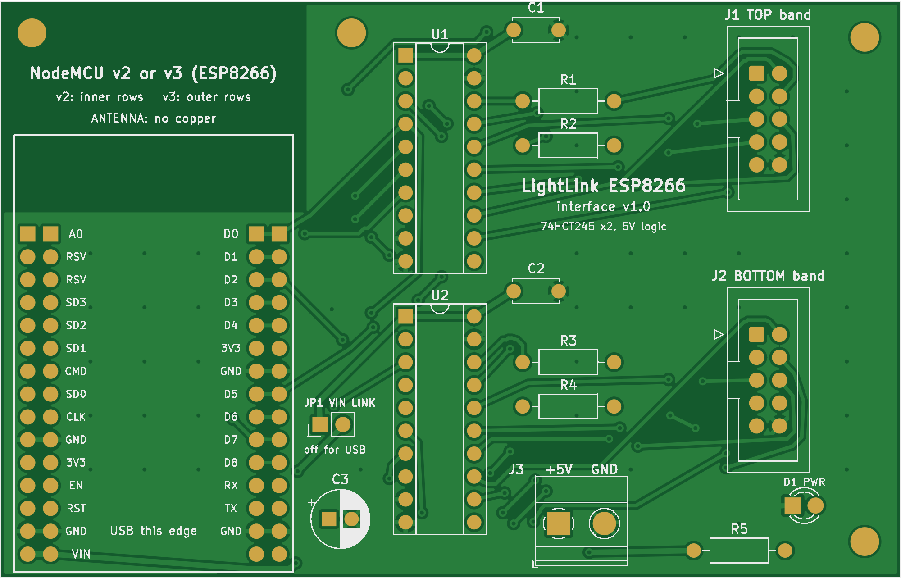
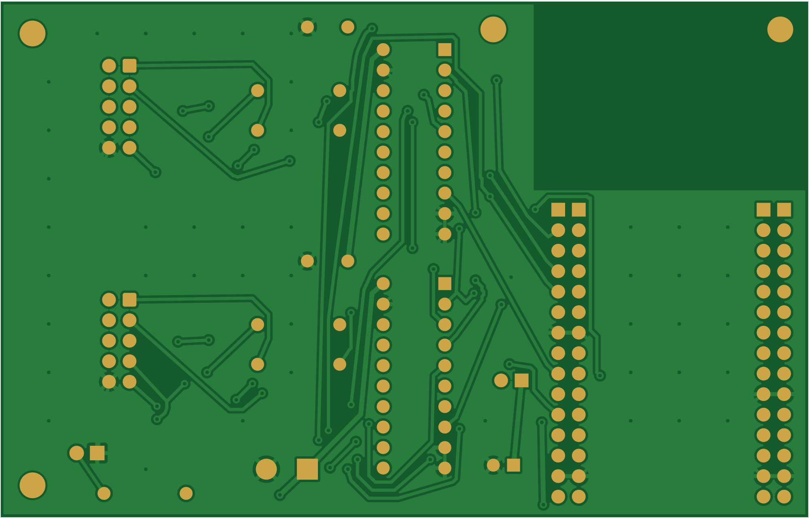

# Interface PCB

A two-layer, all through-hole board that replaces the breadboard wiring: a NodeMCU, two 74HCT245
buffers, and two shrouded headers that take the original LightLink ribbon cables.

| Top | Bottom |
|---|---|
|  |  |

(Previews of the fabricated board. Drill holes aren't drawn.)

- [What's on the board](#whats-on-the-board)
- [Files](#files)
- [Ordering from PCBWay](#ordering-from-pcbway)
- [Bill of materials](#bill-of-materials)
- [Assembly](#assembly)
- [First power-up](#first-power-up)
- [Using JP1 (VIN link)](#using-jp1-vin-link)
- [Viewing and editing on a Mac](#viewing-and-editing-on-a-mac)
- [Design notes](#design-notes)

## What's on the board

| Ref | Part | Purpose |
|---|---|---|
| MCU | NodeMCU **v2 (Amica) or v3 (LoLin)** | Dual footprint: v2 goes in the **inner** rows (0.9" apart), v3 in the **outer** rows (1.1"). Antenna end toward the top edge, USB end hanging off the bottom edge. |
| U1, U2 | 74HCT245 (in DIP-20 sockets) | 3.3 V → 5 V buffers. U1 drives the top band, U2 the bottom band. |
| J1, J2 | 2x5 shrouded box headers | Plug in the original ribbons: **J1 = top band**, **J2 = bottom band**. |
| J3 | 2-way 5.08 mm screw terminal | **+5 V and GND from the sign's supply** (the same supply that feeds the panels). |
| JP1 | 2-pin header + jumper | Links the board's 5 V to the NodeMCU's VIN. Remove it when USB is plugged in. |
| R1-R4 | 33 Ω | Series damping on SRCK and RCK for each ribbon |
| C1, C2 | 100 nF | Decoupling at each 74HCT245 |
| C3 | 100 µF | Bulk capacitor on the 5 V rail |
| D1, R5 | LED + 1 kΩ | 5 V power indicator |

The connections match the [wiring diagram](images/wiring.png) exactly, and the firmware's pin
assignments don't change.

Size: **100 x 64 mm**, 4 x M3 mounting holes.

## Files

All in [`hardware/pcb/`](../hardware/pcb/):

| File | What it is |
|---|---|
| `lightlink-interface-gerbers-pcbway.zip` | **Upload this to PCBWay.** Copper, mask, silkscreen, outline and drill files. |
| `gerbers/` | The same files unzipped, plus drill maps and a Gerber job file |
| `lightlink-interface.kicad_pro`, `.kicad_pcb`, `.kicad_dru` | KiCad project (KiCad 7 format; opens in 8 and 9) |
| `bom.csv` | Bill of materials |
| `images/` | Board previews |
| `scripts/` | The Python scripts that generated, routed and checked the board |

## Ordering from PCBWay

1. Go to **pcbway.com → PCB Instant Quote → Quick-order PCB**.
2. Click **+ Add Gerber file** and upload `lightlink-interface-gerbers-pcbway.zip`. PCBWay reads the
   size (100 x 64 mm) and layer count from it.
3. Check the options below, then **Save to Cart**. PCBWay's engineers review the files before you pay;
   this usually takes under an hour.

| Option | Choose | Why |
|---|---|---|
| Board type | Single pieces | |
| Different design in panel | 1 | |
| Size | 100 x 64 mm (auto) | Under 100 x 100 mm keeps it in the cheapest price tier |
| Quantity | 5 (the minimum) | |
| Layers | **2** | |
| Material | FR-4, TG130-140 | Standard |
| Thickness | **1.6 mm** | Standard; suits the screw terminal and box headers |
| Min track / spacing | **6/6 mil** | The design uses 0.2 mm (8 mil) clearance and 0.4 mm tracks |
| Min hole size | **0.3 mm** | The smallest drill is 0.45 mm (vias) |
| Solder mask | Green (any colour works) | |
| Silkscreen | White | |
| Edge connector | No | |
| Surface finish | **HASL with lead** or **HASL lead-free** | Both are easy for hand-soldering through-hole parts. ENIG isn't needed. |
| Via process | **Tenting vias** | |
| Finished copper | **1 oz** | Plenty for this board's current |
| Remove product No. | Optional | PCBWay may print a small order number on the silkscreen. "Specify a location" or "No" removes it, sometimes for a small fee. |
| Assembly / stencil | **None** | You're assembling it yourself, and there are no SMD parts. |

Other boxes (gold fingers, castellated holes, impedance control, etc.) stay off or at their defaults.

Before paying, open PCBWay's **online Gerber viewer** for the uploaded file and check that the
outline, both copper layers, the white labels and the holes all look like the previews above.

## Bill of materials

Also in [`hardware/pcb/bom.csv`](../hardware/pcb/bom.csv).

| Ref | Qty | Part | Example source |
|---|---:|---|---|
| U1, U2 | 2 | **74HCT245**, DIP-20 (HCT, AHCT or ACT, not plain HC) | [Juried Engineering SN74HCT245N 5-pack](https://www.amazon.com/Juried-Engineering-SN74HCT245N-Transceivers-Breadboard-Friendly/dp/B08FZN8WM1) |
| - | 2 | DIP-20 IC socket, 0.3" (recommended) | [Juried Engineering machined DIP-20, 5-pack](https://www.amazon.com/Juried-Engineering-Sockets-Machined-Breadboard-Friendly/dp/B07K5FGV2M) |
| J1, J2 | 2 | 2x5 shrouded IDC box header, 2.54 mm, straight | [PC Accessories 2x5 shrouded header, 2-pack](https://www.amazon.com/Accessories-2-Pack-2-54mm-Shrouded-Connectors/dp/B009A3VVMY) |
| J3 | 1 | 2-way screw terminal, 5.08 mm pitch (KF301 style) | [5.08 mm 2-pin terminal blocks](https://www.amazon.com/Pieces-2-Pin-Terminal-Connector-5-08mm/dp/B07P7WGHZX) |
| JP1 | 1 | 1x2 pin header 2.54 mm + jumper shunt | parts bin |
| R1-R4 | 4 | 33 Ω ¼ W axial (anything 22-100 Ω works, e.g. 47 Ω) | parts bin |
| R5 | 1 | 1 kΩ ¼ W axial | parts bin |
| C1, C2 | 2 | 100 nF ceramic, code **104**, 5 mm lead spacing | [DYWISHKEY ceramic capacitor kit](https://www.amazon.com/DYWISHKEY-Monolithic-Multilayer-Capacitors-0-1uF-100nF/dp/B07QGDGGZV) |
| C3 | 1 | 100 µF electrolytic, 10 V or more, 2.5 mm leads, ≤ 6.3 mm dia (47-220 µF is fine) | parts bin |
| D1 | 1 | 3 mm LED, any colour | parts bin |
| MCU | 1 | NodeMCU ESP8266 v2 or v3, with pins | you have these |
| (optional) | 4 | M3 standoffs and screws | |

## Assembly

Solder from the lowest parts to the tallest, checking orientation as you go:

1. **R1-R5** (no polarity).
2. **C1, C2** (no polarity).
3. **D1:** the **square pad is the cathode**: the LED's flat side / short leg.
4. **DIP-20 sockets:** notch toward the **top edge**, matching the silkscreen half-moon. The square pad is pin 1.
5. **JP1** header.
6. **C3:** the **square pad is +**. The long leg goes there; the striped side goes to the other pad.
7. **J1, J2 box headers:** the key slot faces the **centre of the board**, matching the silkscreen gap.
   That's the orientation that makes the ribbon's red stripe land on pin 1 (the square pad).
8. **J3** terminal, wire openings facing the **bottom edge**. The left screw is **+5V**, the right is **GND** (labelled).
9. **NodeMCU last.** Use the inner rows for a v2, the outer rows for a v3. A0 / D0 go toward the
   **top** (antenna end); the USB connector hangs off the **bottom** edge. Solder two opposite corner
   pins, check it sits flat, then do the rest.
   - Once soldered, the NodeMCU is hard to remove. If you'd like it removable, solder two 1x15 female
     headers into the board first; the USB end still clears the edge.

Leave the 74HCT245s out of their sockets until after the first power-up check.

## First power-up

1. **Before power:** with a meter on continuity, check that **+5V and GND are not shorted** (across J3).
2. Fit the JP1 jumper. Connect J3 to the sign's 5 V supply (or a bench 5 V supply), **without**
   the 74HCT245s, NodeMCU USB or ribbons connected.
3. Power on. D1 should light. Measure about **5 V** on each socket between pin 20 (+) and pin 10 (−),
   and on the NodeMCU's VIN pin.
4. Power off. Insert U1 and U2 (notch toward the top edge). Plug the **top band** ribbon into **J1** and the
   **bottom band** into **J2**.
5. Power on. The sign should scroll its hostname and IP, then carry on exactly as with the breadboard.
   If anything looks wrong, run the ident test ([setup.md](setup.md#4-bring-up-tests)).

## Using JP1 (VIN link)

| Situation | JP1 | Notes |
|---|---|---|
| Normal operation | **On** | The NodeMCU runs from the sign's 5 V |
| USB plugged in (flashing, serial console) | **Off** | Keeps USB 5 V and the sign's 5 V apart |

When flashing over USB, **leave the sign powered on** with JP1 off. The 74HCT245s run from the sign's 5 V,
so they don't hold the ESP8266's boot pins low, and the ESP runs from USB. (If the sign is off, the
unpowered 245s can stop the ESP from booting.) After the first flash you can update over WiFi
instead, so this is rarely needed.

## Viewing and editing on a Mac

1. Install **KiCad** (free), either from [kicad.org/download/macos](https://www.kicad.org/download/macos/)
   or with Homebrew:
   ```
   brew install --cask kicad
   ```
   It's a universal app, so it runs natively on Apple Silicon.
2. Open `hardware/pcb/lightlink-interface.kicad_pro`. KiCad 8 or 9 offers to upgrade the file from
   KiCad 7 format; that's fine.
3. Useful views:
   - **View → 3D Viewer** for a rendered board with parts
   - **Inspect → Design Rules Checker** for DRC
   - KiCad's **Gerber Viewer** app: open the PCBWay zip to see exactly what you're ordering
4. To re-export Gerbers after changes: **File → Fabrication Outputs → Gerbers** (layers F.Cu, B.Cu,
   F.Mask, B.Mask, F.Silkscreen, Edge.Cuts) and **Drill Files** (Excellon, mm, PTH and NPTH in
   separate files). Zip them together.

### Re-running the scripts (optional)

The board was generated by `scripts/gen.py` (placement, nets, outline, silkscreen) and
`scripts/route.py` (a small two-layer maze router plus ground pours). `scripts/check.py` runs KiCad's
DRC. They use KiCad's Python API. On a Mac, use the Python that ships with KiCad, plus numpy:

```
KPY=/Applications/KiCad/KiCad.app/Contents/Frameworks/Python.framework/Versions/Current/bin/python3
$KPY -m pip install numpy
$KPY scripts/gen.py placed.kicad_pcb
$KPY scripts/route.py placed.kicad_pcb routed.kicad_pcb
$KPY scripts/check.py routed.kicad_pcb drc.rpt
```

The scripts read footprints from the Linux library path `/usr/share/kicad/footprints/`. On a Mac,
change the `FP` line in `gen.py` to
`/Applications/KiCad/KiCad.app/Contents/SharedSupport/footprints/`. The scripts target KiCad 7's API;
KiCad 8 and 9 renamed a few calls. For small changes, editing in the KiCad GUI is easier.

## Design notes

- **Connections:** every net on the board was cross-checked against the working breadboard wiring
  (34 checks: each 74HCT245 pin, both resistors, every ribbon pin, the NodeMCU rows). KiCad DRC reports
  **0 unconnected pads and 0 clearance or electrical violations**.
- **Design rules:** 0.4 mm signal tracks, 0.6 mm for +5V and VIN, 0.2 mm clearance, 0.9 / 0.45 mm vias,
  GND pours on both layers with stitching vias.
- **Antenna keepout:** no copper under the ESP-12's antenna (the top-left area), so WiFi range
  isn't reduced.
- **Unused NodeMCU pins** are left unconnected, including both 3V3 pins and the v3's VU (USB 5 V) pin.
- **Ribbon pin 8** is unconnected, and pins 4 and 7 both carry SRCK, as on the original controller.
- There's no separate schematic; the [wiring diagram](images/wiring.png) and [hardware.md](hardware.md)
  are the reference.
- **Status:** this is the first revision of the board. It hasn't been fabricated yet, so check the
  first boards with the power-up steps above.
