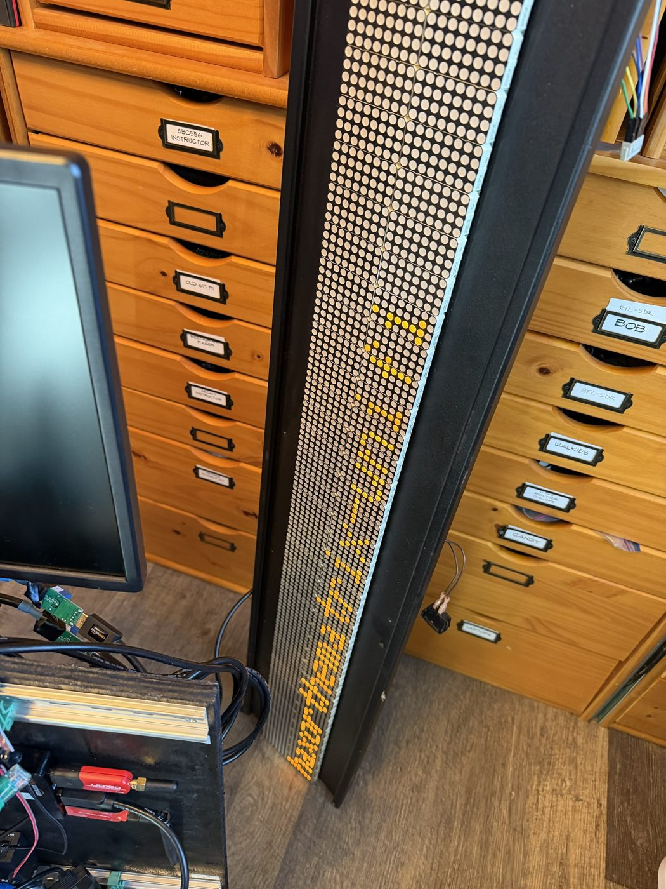
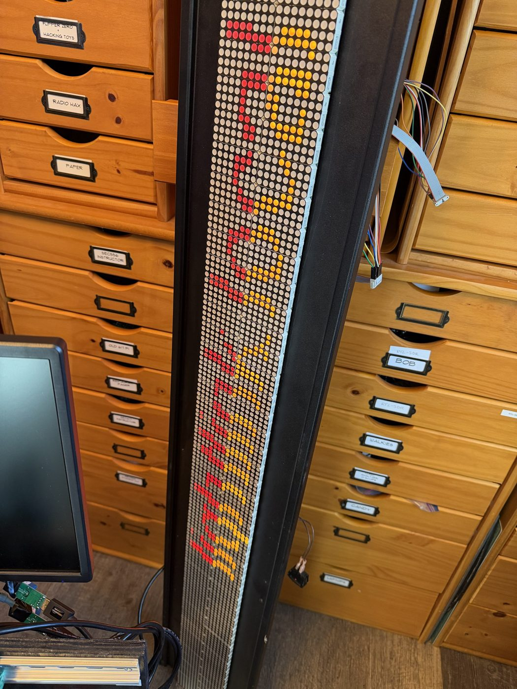
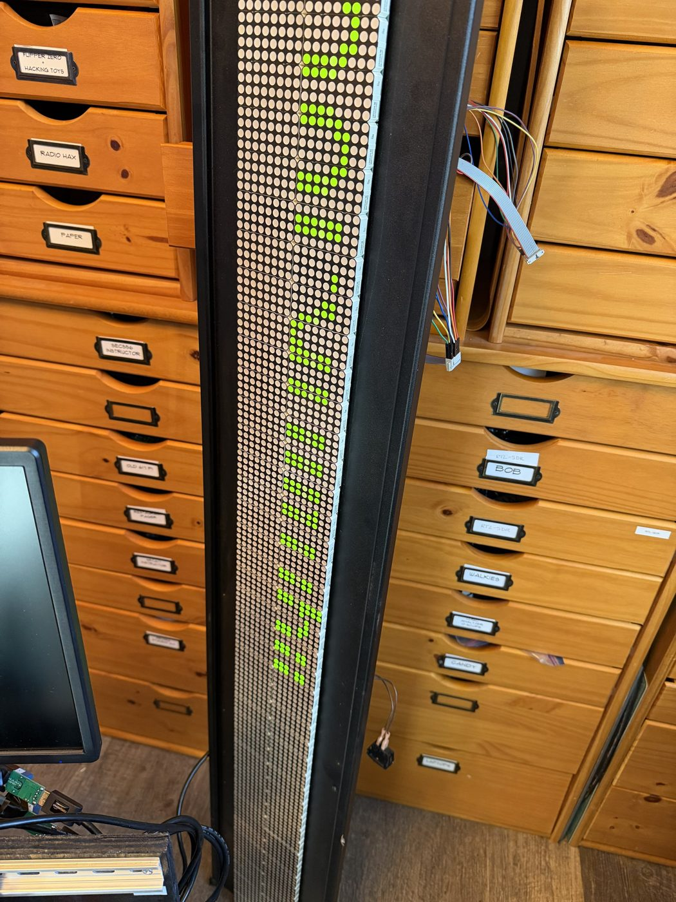

# Troubleshooting

## Reading the symptoms

Each band has two independent data lines (red and green). All bands share the clock, latch and
row-address lines. That makes most wiring faults easy to pin down from what the sign shows:

| Symptom | Likely cause |
|---|---|
| One band never shows **green** (orange shows as red, green text is invisible) | That band's GREEN data line: D6 (top) or D2 (bottom), its 74HCT245 pin 8 → pin 12, ribbon pin 9 |
| One band never shows **red** (orange shows as green) | That band's RED data line: D7 (top) or D1 (bottom), 74HCT245 pin 7 → pin 13, ribbon pin 2 |
| A whole band is dark, the other works | That band's ribbon, its 74HCT245 power, or ribbon pin 10 (GND) |
| Rows doubled, missing or in the wrong order | A row-address wire: ROW_A / ROW_B / ROW_C (D0 / D3 / D4, ribbon pins 5 / 6 / 3) |
| Nothing at all, or random flashing | SRCK / RCK (D5 / D8, ribbon pins 4 + 7 and 1), shared ground, or the 245s not powered |
| First panels fine, far panels speckled or garbled | Shift clock too fast for the chain: add the 33 Ω resistors, then raise `SHIFT_NOPS` ([building.md](building.md#build-options)) |
| Mirrored, upside-down, or bands swapped | Not a fault: use the toggles on the **Setup** tab |

### A real example: top band missing green

This happened during the first bring-up. The top band's GREEN input had been wired to ground instead of D6:

| | | |
|---|---|---|
|  |  |  |
| **Boot screen:** line 1 is green and sits in the top band, so it's invisible. Only the orange line 2 in the bottom band shows. | **Orange scroll:** the tops of the letters (top band) show **red**, the bottoms (bottom band) show orange. The top band has red but no green. | **Green scroll:** only the bottom band lights. |

(The sign is standing on end in these photos; the text reads bottom to top.)

Moving the wire to D6 fixed it.

### Finding a broken line with a voltmeter
Data lines sit at a steady level during a solid-color test pattern, so a DC meter is enough:

1. **Setup → green**: green lines are high, red lines low.
2. Measure from the D1 mini pin, through the 74HCT245 input and output, to the ribbon pin:

| Line | D1 mini | 245 input | 245 output | Ribbon |
|---|---|---|---|---|
| Top GREEN | D6 ≈ 3.3 V | U1 pin 8 ≈ 3.3 V | U1 pin 12 ≈ 5 V | top pin 9 ≈ 5 V |
| Bottom GREEN | D2 ≈ 3.3 V | U2 pin 8 ≈ 3.3 V | U2 pin 12 ≈ 5 V | bottom pin 9 ≈ 5 V |

3. **Setup → red**: the same check for D7 / D1 → pin 7 → pin 13 → ribbon pin 2.

The first point that reads about 0 V is where the break is.

## Boot, WiFi and access

| Symptom | Fix |
|---|---|
| ESP won't boot or won't flash while wired in | The 74HCT245s are unpowered and pulling the boot pins low. Power them (USB → D1 mini 5V pin) or unplug them. |
| No serial port appears | Try a USB data cable; install the CH340 or CP210x driver ([flashing.md](flashing.md#2-find-the-serial-port)) |
| Can't find the sign after entering WiFi | It only sees 2.4 GHz networks. After ~20 s of failing it brings back the LightLink-XXXX network; join it and check the password. |
| `<hostname>.local` doesn't resolve | Use the IP shown on the sign at boot or in your router. Some networks block mDNS between VLANs. |
| Forgot the web password | Reflash with `erase-flash` ([flashing.md](flashing.md#3-erase-and-flash)). This also wipes WiFi, playlist and files. |
| `{time}` shows `--:--` | No NTP reply yet. Check internet access and the NTP server in Settings. |

## Sequences and live data

| Symptom | Fix |
|---|---|
| Upload says "compressed fseq" | Re-export from xLights as **V2 Uncompressed** |
| Upload fails part way | The filesystem is full (about 3 MB). Delete files on the **Files** tab or shorten the sequence. |
| Every other row reversed | Tick **Serpentine rows** in Settings |
| Image upside down | Tick **Origin bottom-left** |
| Image shifted or partial | Wrong **FSEQ start channel**, or the model isn't 200 x 16 |
| Blue parts of the effect don't show | Expected: the sign has only red and green LEDs |
| FPP / xLights output does nothing | Check the IP and the protocol (DDP port 4048, E1.31 port 5568, unicast). The status line shows `live` and the packet source while data arrives. |
| Sign flickers briefly during uploads or updates | Normal: the flash chip is busy |

## Getting more detail

- **Serial console** at 115200 baud shows boot messages and the IP address.
- `GET /api/status` returns the current mode, item, last error, free heap and refresh rate.
- `GET /api/frame` returns exactly what the controller is sending to the panels, so you can tell
  firmware problems from wiring problems.
