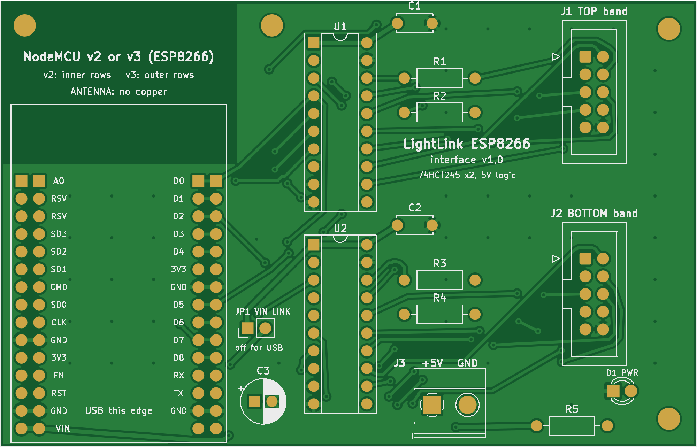

# LightLink ESP8266 interface PCB (rev 1.0)

- **Order:** upload `lightlink-interface-gerbers-pcbway.zip` to PCBWay (2 layers, 1.6 mm, 1 oz, HASL).
- **Parts:** `bom.csv`
- **Everything else** (ordering options, assembly, jumper use, editing in KiCad on a Mac):
  [docs/pcb.md](../../docs/pcb.md)
